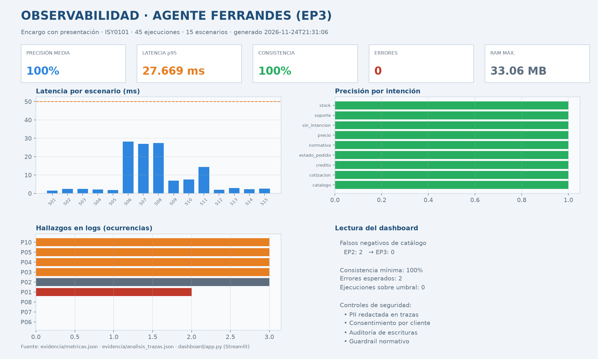

# Informe Técnico EP3 — Agente Ferrandes (FERRANDES)

**Evaluación Parcial N°3 · ISY0101 · Encargo con Presentación (35 %)**
Integrante: Leandro Marin · Docente: Juan Burgueño · Fecha: semana 18

## 1. Contexto y objetivo
Se continúa el agente B2B de la EP2 con foco en **observabilidad**: medir precisión, latencia y consistencia bajo variabilidad de datos; analizar registros; construir un dashboard; proponer mejoras; e integrar seguridad y uso responsable. Se ejecutaron **45 ejecuciones** (15 escenarios × 3 repeticiones) sobre el agente real.

## 2. Métricas implementadas (IE1, IE2)
| Métrica | Definición operativa | Resultado |
| :-- | :-- | --: |
| Precisión | 0,4 intención + 0,4 Jaccard(tools) + 0,2 palabra clave | 100% |
| Latencia | ms de pared; p50 / p95 / máx | 2.644 / **27.669** / 28.154 ms |
| Consistencia | respuesta modal tras normalizar IDs (mínimo) | 100% (100%) |
| Tasa de errores | errores inesperados / escenarios | 0% (0) |
| Recursos | RSS máx / CPU media | 33.06 MB / 86.85% |

Umbral de alerta: 50.0 ms. Errores esperados (datos inexistentes): 2.

## 3. Análisis de registros y trazabilidad (IE3)
Se examinaron 45 trazas instrumentadas y 166 registros históricos de la EP2.

| ID | Hallazgo | Severidad | N | Estado | IE |
| :-- | :-- | :-- | --: | :-- | :-- |
| P01 | Falso negativo por codigo de producto incompleto | alta | 2 | corregido | IE3 / IE6 |
| P02 | Dato inexistente correctamente informado | informativa | 3 | monitoreado | IE1 / IE3 |
| P03 | Replanificacion ante items invalidos | media | 3 | corregido | IE6 / IE7 |
| P04 | Pedido retenido por politica de credito | media | 3 | monitoreado | IE3 / IE8 |
| P05 | Derivacion de consulta normativa a especialista | media | 3 | corregido | IE8 |
| P06 | Latencia por encima del umbral de alerta | informativa | 0 | monitoreado | IE2 / IE7 |
| P07 | Respuestas no consistentes entre repeticiones | informativa | 0 | corregido | IE1 / IE3 |
| P08 | Trazas sin identificador o sin spans | informativa | 0 | corregido | IE3 / IE6 |
| P10 | PII redactada antes de persistir la traza | media | 3 | corregido | IE8 |

**Correcciones ejecutadas:** (P01) extracción de códigos con patrón genérico `\b[A-Z]{3}-\d{3}\b` → 2 falsos negativos en EP2, 0 en EP3; (P03) ítems con prefijo desconocido ahora entran al planificador y se replanifican; (P08) cada ejecución emite `trace_id` y spans de clasificación, RAG, ejecución y registro. Detalle en `evidencia/Analisis_Logs_EP3.md`.

## 4. Dashboard de monitoreo (IE4)

*Figura 1. Vista general del dashboard (misma fuente que la app Streamlit).*

La aplicación interactiva `dashboard/app.py` permite filtrar por escenario, ver latencia, precisión por intención, consistencia por variabilidad, hallazgos y controles de seguridad. Réplica estática: `dashboard/dashboard.html`.

## 5. Seguridad, privacidad y uso responsable (IL3.3 / IE8)
| Control | Implementación | Verificación |
| :-- | :-- | :-- |
| Minimización de datos | `redactar()` antes de persistir (RUT, email, teléfono, tarjeta, IP) | 0 PII en `trazas_ep3.jsonl` |
| Consentimiento | Registro por cliente y finalidad (`consentimientos.json`) | 15/15 registros cubiertos |
| Auditoría | `auditoria_seguridad.jsonl` para cada escritura | activo |
| Trazabilidad | `trace_id` + spans + estado por ejecución | 0 trazas incompletas |
| Guardrail normativo | Derivación a especialista en consultas EPP/normativa | 3 derivaciones registradas |

Marco: Ley 19.628 y Ley 21.719 (Chile), NIST AI RMF 1.0, OWASP Top 10 for LLM Applications.

## 6. Recomendaciones basadas en datos (IE5 / IE7)
1. **Caché de recuperación y paralelismo:** los flujos de pedido concentran la latencia (27.669 ms p95 vs. 2.644 ms p50); ejecutar validaciones independientes en paralelo y cachear TF-IDF.
2. **Alertas por variabilidad:** publicar p95 y tasa de error por intención en el dashboard; umbral 50.0 ms.
3. **Escalabilidad:** sustituir SQLite por PostgreSQL y el retriever léxico por embeddings + vector store, conservando la interfaz de herramientas.
4. **Gobernanza:** revisión trimestral de consentimientos, rotación de claves y purga de trazas; mantener la redacción de PII en todo el pipeline.

## 7. Evidencia, pruebas y referencias
- 45 pruebas unitarias (`python tests/ejecutar_tests.py`), todas OK; 15 escenarios instrumentados; logs históricos y EP3.
- Scripts reproducibles: `scripts/evaluar_observabilidad.py`, `scripts/generar_dashboard.py`, `dashboard/app.py`.
- Declaración de IA: se usó asistencia de IA para estructura de código, gráficos y borradores técnicos. Las decisiones de diseño, el análisis de causas y las reflexiones son de autoría del equipo. Fuente: https://bibliotecas.duoc.cl/ia
- Referencias APA: Anthropic (2026); LangChain (2026); NIST (2023); OWASP Foundation (2025); Duoc UC (2026); Biblioteca del Congreso Nacional de Chile (2024).

## 8. Conclusiones y reflexiones individuales
⬅ **REDACTAR SIN APOYO DE IA** — Leandro Marin: aprendizaje y contribución (3-5 líneas).
